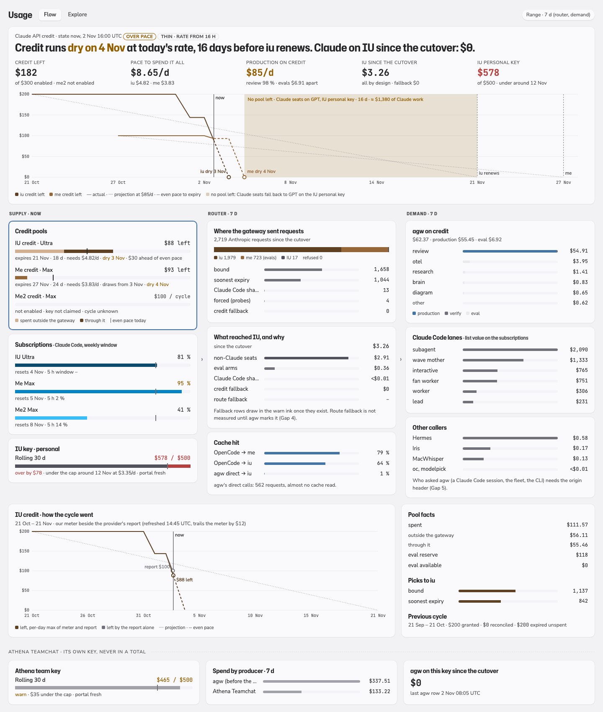
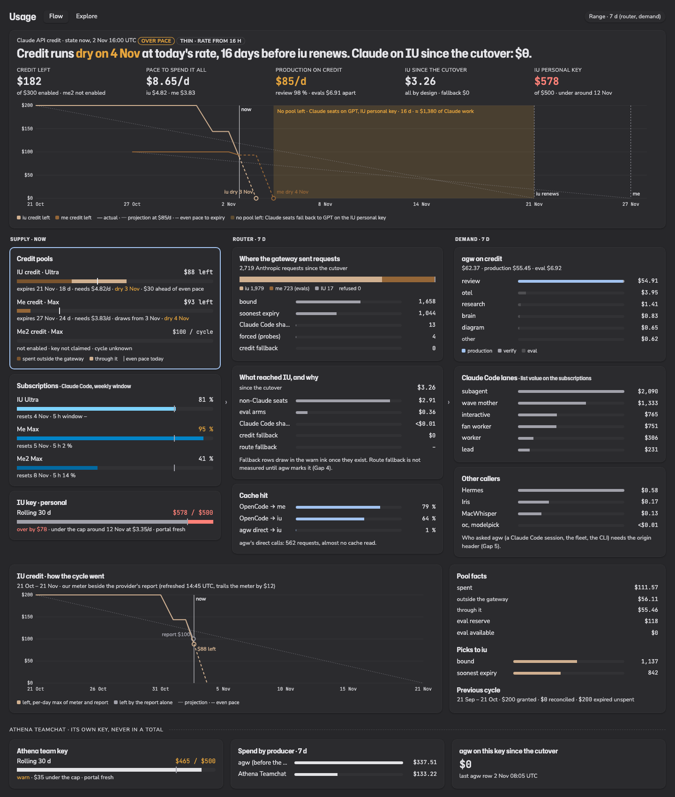
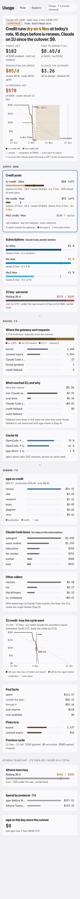
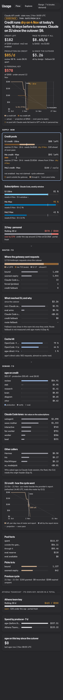

# Usage Tracking — spec (v7, the money flow)

> **Status: draft for the owner's sign-off** (agent-workflows Wave 7, 2026-11-02). Nothing below is built. It supersedes
> v6's page (tabs Overview, Claude Max, IU API, Credits); v6 and its build records are in this file's git history at
> `614b5972`. Token accounting, the vocabulary and the IU key reading rules carry over (§Carried from v6).

Route `/usage-tracking` · `apps/dashboard/src/routes/usage-tracking.tsx`, `apps/dashboard/src/features/usage-tracking/` ·
API `/usage/*` over schema `usage` (read-only, role `argo`). Mocks: `docs/design/usage-v7/`.

**TLDR.** The page leads with one verdict: will the Claude API credit be spent before it expires, and does any Claude
work land on the IU key that is over its cap? Under it, three columns follow the money: **supply** (credit pools,
subscription windows, IU keys) → **router** (the gateway's picks, fallbacks, cache) → **demand** (agw workflows, Claude
Code lanes, Hermes, Iris, MacWhisper). Click a node and its detail opens below. Athena Teamchat sits apart, on its own key.
Everything that is analytics rather than money (projects, tools, rhythm, weekly volume) moves to a second tab, Explore.
Terms (list value, spend, thin, the cap states) are defined in §Carried from v6 › Vocabulary.

## For the sign-off

Five decisions; the rest follows from the data below.

| #   | Decision                                                                                                                                              | Recommendation                                            |
| --- | ----------------------------------------------------------------------------------------------------------------------------------------------------- | --------------------------------------------------------- |
| 1   | The verdict judges both directions, and **dry before renewal** is the louder state (warn ink), unspent at expiry the quieter one                      | yes: today's data shows the dry case, not the unspent one |
| 2   | Two tabs, Flow and Explore; Overview, Claude Max, IU API and Credits are deleted; Compared and the picker's Routing move into the subscription detail | yes                                                       |
| 3   | Gaps 4–6 need small agw changes (route-fallback marker, origin header, no double rows); they join Wave 7's build in agent-workflows                   | yes: R2 and D2 cannot be answered without them            |
| 4   | The spill reads in days and in Claude list dollars, labelled as such, never as IU cost                                                                | yes                                                       |
| 5   | The page shows the overflow and changes no routing; pacing production (a cheaper tier when over pace) is a separate gateway decision                  | decide after 7 days of data; claim me2 now                |

## The headline, answered from today's data

As of 2026-11-02 16:00 UTC, the gateway's first day (first row 00:26 UTC, traffic from 08:00).

| Figure                                           | Value                                                                                                                                                                         | Source                                                      |
| ------------------------------------------------ | ----------------------------------------------------------------------------------------------------------------------------------------------------------------------------- | ----------------------------------------------------------- |
| Credit left, iu                                  | **$88.43** of $200, expires 21 Nov (18.3 d)                                                                                                                                   | `credit_cycles`, gateway `api_credit` rows, `platform_cost` |
| Credit left, me                                  | **$93.09** of $100, expires 27 Nov (24.3 d)                                                                                                                                   | same                                                        |
| Credit left, me2                                 | not enabled: $100 a cycle, cycle unknown                                                                                                                                      | gateway `/health`                                           |
| iu spent so far                                  | $111.57 = $56.11 outside the gateway (31 Oct, `platform_cost`) + $55.46 through it (2 Nov)                                                                                    | per-day max of meter and report (§Pace model)               |
| Required pace (left ÷ days left)                 | iu $4.82/d + me $3.83/d = **$8.65/d**                                                                                                                                         | left ÷ days left                                            |
| Production on credit                             | **$85/d**: $55.45 on iu in 15.6 h, purpose ≠ eval; 98 % of it is `review` ($54.30)                                                                                            | gateway rows                                                |
| Evals on credit                                  | $6.91, all on `me` (the eval reserve kept them off `iu`)                                                                                                                      | gateway rows, `purpose = eval`                              |
| Projection at $85/d, pools drained in pick order | iu dry **3 Nov ~17:00 UTC**, me dry **4 Nov ~19:00 UTC**; then 16 days on IU until iu renews on 21 Nov (≈ $1,380 of Claude work at list price)                                | §Pace model                                                 |
| IU spend through the gateway since the cutover   | $3.26: $2.91 non-Claude production seats (GPT Terra $2.50), $0.36 non-Claude eval arms, $0.003 Claude-Code-shaped verify probes, **$0 credit fallback**                       | gateway `api_key` rows, `gateway_picks`                     |
| IU personal key                                  | **$577.57 of $500** over the rolling 30 days; as the mid-October days leave the window and new spend stays at today's $3.35/d, the sum drops under $500 around 12 Nov        | `iu_portal_cost`                                            |
| Athena team key                                  | $465.14 of $500 by the portal (rolling 30 d). Tracked over the last 7 days: agw $337.51 until it moved to the gateway (last agw row 2 Nov 08:05 UTC), Athena Teamchat $133.22 | `iu_portal_cost`, `records`                                 |

**Verdict today: over pace.** The headline asks whether credit expires unspent; it will not, every dollar will be spent. The risk is that
the pools run dry around 4 Nov and the Claude seats fall back to GPT on the over-cap personal key for two weeks. The
rate comes from 16 hours of one heavy fleet day, so the page marks it thin; read over the 8 active hours only, it is
$55/d and the pools last until about 5 Nov. Either way, $400 of monthly credit covers a sixth of today's demand ($85/d ≈ $2,550 a month), a quarter on the
working-hours reading. The headline must therefore judge both directions: unspent at expiry, and dry before renewal.

## What Argo shows today, and where it is wrong

Live `GET /usage/credits/pools`, same instant:

| v6 figure            | Shows                                      | Correct              | Why                                                                                                                                                                                                                    |
| -------------------- | ------------------------------------------ | -------------------- | ---------------------------------------------------------------------------------------------------------------------------------------------------------------------------------------------------------------------- |
| iu credit left       | $100.39                                    | $88.43               | `spent = max(metered, reported)` over the whole cycle. The report lags (today $43.50 of $55.46), so the max misses today's gateway spend. The gateway's own rule is per day: report for complete days, meter for today |
| iu daily rate        | $14.23/d                                   | $85/d                | 7-day mean over days before the gateway existed                                                                                                                                                                        |
| me projected unspent | $69.09                                     | ≈ $0                 | each pool is projected alone at its own rate; me's $0.99/d is eval only. The router drains iu first (soonest expiry), then me, so me's future depends on iu's dry date                                                 |
| Dry date, IU spill   | absent                                     | 3 Nov, 16 days       | the projection is floored at $0 and never says when or what happens next                                                                                                                                               |
| IU since the cutover | spread over the IU API tab, no cause       | $3.26, all by design | no split by cause (by design, Claude Code shape, forced, credit fallback, route fallback)                                                                                                                              |
| IU personal tracked  | includes $5.01 of agw rows since 08:10 UTC | $3.26                | double rows, Gap 6                                                                                                                                                                                                     |

The structure fails the question too: answering it takes all four tabs, and none of them says whether Claude work reached
IU.

## Mental model: supply → router → demand

| Column | Node                                      | What it is                                                                                                                                                                   | Data                                                             |
| ------ | ----------------------------------------- | ---------------------------------------------------------------------------------------------------------------------------------------------------------------------------- | ---------------------------------------------------------------- |
| Supply | Credit pool `iu`, `me`, `me2`             | API credit each subscription grants its Console org, $200/$100/$100 a cycle, expires unspent                                                                                 | `credit_cycles`, `records` `billing=api_credit`, `platform_cost` |
| Supply | Subscription `iu`, `me`, `me2`            | Claude Code's 5 h and weekly windows; never through the gateway                                                                                                              | `quota_samples`, `account_picks`                                 |
| Supply | IU key `personal`                         | metered, rolling 30-day $500 cap; pays the non-Claude seats and any fallback                                                                                                 | `iu_portal_cost`, `records` `api_key=personal`                   |
| Router | Gateway                                   | one pick per Anthropic request: pool, IU passthrough or refusal, with a reason; caches per org                                                                               | `gateway_picks`, gateway rows' `lane_detail`                     |
| Router | Account picker                            | which subscription a Claude Code lane runs on                                                                                                                                | `account_picks`                                                  |
| Demand | agw workflows                             | review, research, otel, brain, podcast, evals; each a workflow and step on credit or IU                                                                                      | gateway rows `lane_detail.{workflow,step,purpose}`               |
| Demand | Claude Code lanes                         | interactive, wave mother, lead, worker, fan worker, subagent                                                                                                                 | `records` `source=claude-code`, `billing=max`                    |
| Demand | Hermes, Iris, MacWhisper, `oc`, modelpick | Hermes calls the gateway (45 rows) and IU directly; Iris and MacWhisper reach agw's audio door (`door.transcriptions`, $0.30 a week); `oc` and modelpick are gateway callers | gateway rows, `records` `source in (hermes, agent-workflows)`    |
| Apart  | Athena team key                           | Athena Teamchat's own key; never summed with ours                                                                                                                            | `iu_portal_cost` `iu_key=athena-team`, `records`                 |

## Questions, views, endpoints

| #   | Question                                                                                                         | View                                                                   | Endpoint                                                                                    | Answer today                                                                           |
| --- | ---------------------------------------------------------------------------------------------------------------- | ---------------------------------------------------------------------- | ------------------------------------------------------------------------------------------- | -------------------------------------------------------------------------------------- |
| H   | Are we on pace to spend every credit dollar before it expires, without Claude work touching the over-cap IU key? | Verdict band: sentence, facts, the pace chart                          | `GET /usage/pace` (new)                                                                     | over pace; dry 3–5 Nov; $0 Claude on IU so far                                         |
| S1  | How much credit does each pool have left, until when, at what required pace?                                     | Supply: one pool node each (meter with an even-pace tick)              | `/usage/pace`                                                                               | iu $88 / 18 d / $4.82/d; me $93 / 24 d / $3.83/d                                       |
| S2  | How did a pool's credit go, and how far does our meter differ from the provider's report?                        | Pool detail: burn-down, spent by source, eval reserve, previous cycle  | `/usage/pace` (`pools[].days`)                                                              | iu: $56 outside, $55 through; the report trails the meter by $12 today                 |
| S3  | How much subscription headroom is left this week?                                                                | Supply: one subscription node each (weekly %, reset)                   | `/usage/quota-latest` (kept)                                                                | iu 81 % (resets 4 Nov), me 95 % (5 Nov), me2 41 % (8 Nov)                              |
| S4  | Where does the IU personal key stand against its cap, and when does it fall under?                               | Supply: IU key node; detail: cap, portal vs tracked, what spends on it | `/usage/iu-budget?iuKey=personal` (+ `underCapOn`), `/usage/iu-reconcile` (kept)            | $578 / $500, under around 12 Nov                                                       |
| R1  | Where did the gateway send each request, and why?                                                                | Router: picks by target, reason mix                                    | `GET /usage/router` (new)                                                                   | 2,719 picks: iu 1,979, me 723, IU 17, refused 0                                        |
| R2  | What reached IU, and was any of it Claude work that belonged on credit?                                          | Router: IU spend by cause, fallback and Claude-on-IU in status ink     | `/usage/router` (`iu`)                                                                      | $3.26, all by design; credit fallback $0                                               |
| R3  | Is the prompt cache working per caller and pool?                                                                 | Router: cache hit per caller × target                                  | `/usage/router` (`cache`)                                                                   | OpenCode steps 64 % on iu, 79 % on me; agw's direct calls 0.8 % over 562 requests      |
| D1  | Which workflows and steps spend the credit, and how much is production, eval, verify?                            | Demand: workflow rows split by purpose; detail: steps and models       | `GET /usage/demand` (new)                                                                   | review $54.30 (98 % of production); evals $6.91                                        |
| D2  | Who asked agw: a Claude Code session, the fleet, Hermes, Iris, MacWhisper, the CLI?                              | Demand: origin rows                                                    | `/usage/demand?by=origin`                                                                   | not answerable on gateway rows: Gap 5                                                  |
| D3  | What do the Claude Code lanes draw from the subscriptions?                                                       | Demand: lane rows, list value and fresh tokens per account             | `/usage/split?by=lane` (extended)                                                           | 7 d list value: subagent $2,090, wave mother $1,333, interactive $765, fan worker $751 |
| A1  | What does Athena Teamchat spend on its key, and did anything of ours touch it since the cutover?                 | Athena section: cap meter, spend by producer                           | `/usage/iu-budget?iuKey=athena-team`, `/usage/split?payer[]=iu-team-api&by=sub_tool` (kept) | $465 / $500; agw rows since 08:05 UTC: 0                                               |

## Pace model

The arithmetic behind H, S1 and S2. Pure functions in the API (`lib/usage-pace.ts`), tested on fixtures of today's rows.

- **Spent** per pool and cycle = Σ over the cycle's UTC days of `max(metered_day, reported_day)`; `metered_day` counts a
  row's `cost_usd`, else its `lane_detail.costEstimatedUsd`. The gateway reconciles the same way, so the two agree to
  the headroom ($2 a pool, registry-only, not drawn).
- **Left** = grant − spent. **Required pace** = left ÷ days left.
- **Production rate R** = credit-eligible Claude demand ÷ window: gateway rows on `/anthropic` paths with purpose ≠
  `eval`, on a pool or on IU by fallback. Window: the last 7 × 24 h, clipped to the first gateway row. Under 24 h of
  window the verdict carries **thin**. Evals are excluded: the reserve paces them and they can stop. Their own rate E is
  shown beside R.
- **Waterfall.** Order the enabled pools by cycle end, as the router does. The first draws R from now; it is dry at
  `now + left ÷ R` or expires with `left − R × days` unspent, and the next pool starts drawing at that instant. A disabled
  pool (me2 today) is listed with its grant and draws nothing.
- **Spill** = from the last pool's dry instant to the soonest renewal, `R × days`, in Claude list dollars. In practice the
  agw routes then fall back onto GPT on the personal key, so the real IU cost differs; the label says "Claude work at
  list price", never "IU cost".
- **Verdict.** `over` when the last pool runs dry before the soonest renewal; `under` when any pool expires with more
  than max($5, 5 % of grant) unspent; else `on-pace`; `no-pool` when none is enabled. An independent second clause
  reports Claude on IU since the cutover (credit fallback + route fallback + Claude-Code-shaped), status ink above $1.
- **Eval reserve** per pool = grant × days left ÷ cycle days, the gateway's formula, recomputed here (the gateway's
  `/health` is loopback-only). The pool detail shows reserve and eval-available.

## Page structure

Two tabs: **Flow** (default) and **Explore**. The Account and Key controls and the per-wallet tabs are gone: selecting a
node replaces them.

### Flow

```
1 Verdict   one sentence (the verdict + the IU clause), a facts strip, the pace chart:
            credit left per pool on a calendar axis — actual (solid, pool shade), even pace (thin neutral),
            projection at R (dashed), dry markers, expiry rules, the IU spill as a warn band
2 Flow      three columns of node cards, columns joined by a thin chevron rule
            Supply                        Router                           Demand
            Credit pools  meter + tick    Picks by target  bar             agw workflows on credit  rows, purpose split
            Subscriptions weekly %        IU spend by cause bar            Claude Code lanes  rows (list value)
            IU key        cap meter       Cache hit  per caller            Other callers  Hermes, Iris, MacWhisper, oc
3 Detail    the selected node at full width (?node=pool:iu, sub:me, key:personal, router, demand:review, …)
4 Athena    apart, below a divider: the team key's cap, its spend by producer, "agw on this key since the cutover"
```

| Node         | Detail blocks                                                                                                                                                                                                             | Endpoint                                                                                 |
| ------------ | ------------------------------------------------------------------------------------------------------------------------------------------------------------------------------------------------------------------------- | ---------------------------------------------------------------------------------------- |
| Pool         | burn-down (meter, report, even pace, projection, expiry), spent through vs outside the gateway, eval reserve and eval available, picks to this pool by reason, top workflows on it, previous cycle reconciled and unspent | `/usage/pace`, `/usage/router`, `/usage/demand?payer[]=<pool>-credit`                    |
| Subscription | weekly quota sawtooth (v6 Weekly quota), the compared row (v6 Compared: list value, value multiple, tokens, active days), the account picker's routing (v6 Routing section, its own range)                                | `/usage/quota`, `/usage/split`, `/usage/account-picks*`, `/usage/routing/windows` (kept) |
| IU key       | cap meter, can spend today, under-cap date, portal vs tracked (v6, one key), top spenders and cost per 1 M (v6)                                                                                                           | `/usage/iu-budget`, `/usage/iu-reconcile`, `/usage/flow` (kept)                          |
| Router       | picks per day by target, reason mix, refusals by reason, IU spend per day by cause, cache per caller × target                                                                                                             | `/usage/router`                                                                          |
| Workflow     | steps × model, purpose split per day, cost per run, cache hit per step                                                                                                                                                    | `/usage/demand?workflow=<w>&by=step`                                                     |

**Controls.** Range (default 7 d) drives the Router and Demand columns and the detail lists; the verdict and the Supply
column are state ("now", the cycle) and say so. Measure is `$` on Flow; tokens show in the node detail beside the
dollars. No Workspace on Flow: supply has none.

**Mobile 390.** One column: verdict, then Supply, Router, Demand as stacked node cards; a tapped node's detail opens
directly under it. The pace chart keeps its full height.

### Explore

v6's analysis blocks, across every payer at once, with a **Payer** multi-select (subscriptions, credit pools, IU keys)
instead of one tab per wallet: Over time (group by payer, tool, model, project), Projects | Tools rows with their daily
timelines, Rhythm, Weekly volume. Range, Measure, Workspace, Grain as in v6. Athena team is off by default and never in
an "all".

## Endpoints

New, each with `range` where it reads rows, a decided empty shape, never a 404:

```ts
GET /usage/pace → {
  asOf: string; cutover: string                       // first gateway row
  verdict: 'on-pace' | 'under' | 'over' | 'no-pool'; thin: boolean
  rate: { productionUsdPerDay: number; evalUsdPerDay: number; windowHours: number }
  pools: {
    account: 'iu' | 'me' | 'me2'; enabled: boolean; note: string | null   // 'not enabled', 'cycle unknown'
    grantUsd: number; cycle: { start: string; end: string | null; status: CycleStatus }
    spentUsd: number; meteredUsd: number; reportedUsd: number | null; outsideUsd: number; reportedAt: string | null
    leftUsd: number | null; daysLeft: number | null; requiredUsdPerDay: number | null
    evalReserveUsd: number | null; evalAvailableUsd: number | null
    projection: { drawsFrom: string | null; dryAt: string | null; unspentAtEndUsd: number | null }
    days: { day: string; meteredUsd: number; reportedUsd: number | null; leftUsd: number }[]
    previous: { start: string; end: string; grantUsd: number; reconciledUsd: number | null; unspentUsd: number | null } | null
  }[]
  spill: { from: string; until: string; days: number; claudeListUsd: number } | null
  claudeOnIuUsd: number                               // since the cutover: credit + route fallback + Claude-Code-shaped
  personalKey: { rolling30Usd: number; capUsd: number; state: 'ok' | 'warn' | 'over'; underCapOn: string | null; fetchedAt: string | null }
}

GET /usage/router?range → {
  picks: { day: string; target: string; reason: string; n: number }[]   // target: pool id | 'iu-api' | 'refused'
  iu: { day: string; cause: 'design' | 'eval' | 'claude-code' | 'forced' | 'credit-fallback' | 'route-fallback'; usd: number; requests: number }[]
  cache: { caller: string; target: string; requests: number; hitRate: number | null }[]
}

GET /usage/demand?range&by=workflow|step|model|origin|caller|repo&workflow&purpose[]&payer[] → {
  rows: { key: string; usd: number; freshTokens: number; cacheReadTokens: number; requests: number; runs: number;
          byPurpose: Record<'prod' | 'eval' | 'verify' | 'other', number>; byPayer: Record<string, number> }[]
  totals: { usd: number; requests: number }
}
```

`/usage/demand` reads gateway rows plus agw's own media rows (the `x-agw-usage: caller` exception), never both for one
call (Gap 6). `/usage/router`'s `iu.cause`: a non-Anthropic path is `design` (or `eval` by purpose); an Anthropic path
takes its pick reason (`claude-code`, `forced`, `no-pool`/`drained-retry` → `credit-fallback`). `route-fallback` needs
Gap 4; until then it reads 0 and the router detail says it is not measured yet.

Extended: `/usage/iu-budget` gains `underCapOn` (first day the rolling 30-day sum drops under the cap at the last 7
days' mean); `/usage/split` gains `by=lane`.

Deleted: `/usage/credits/pools`, `/usage/credits/picks`, `/usage/credits/cache` (folded into `pace` and `router`).
Kept as they are: `quota`, `quota-latest`, `account-picks`, `account-picks/summary`, `routing/windows`, `iu-reconcile`,
`split`, `timeseries`, `rhythm`, `flow`, `breakdown`, `summary` (Tinycast reads it).

## Data gaps and what closes them

| #   | Gap                                                                                                                     | Effect on the page                                                                                               | Closes it                                                                                                                                           |
| --- | ----------------------------------------------------------------------------------------------------------------------- | ---------------------------------------------------------------------------------------------------------------- | --------------------------------------------------------------------------------------------------------------------------------------------------- |
| 1   | Spent was a cycle-wide max of meter and report                                                                          | iu credit left overstated by $14 today                                                                           | `/usage/pace` per-day max; data exists                                                                                                              |
| 2   | Pools projected independently                                                                                           | me shown $69 unspent; no dry date                                                                                | `/usage/pace` waterfall; data exists                                                                                                                |
| 3   | 16 hours of gateway history                                                                                             | R is thin; the verdict says so                                                                                   | time: 7 days on 9 Nov                                                                                                                               |
| 4   | agw's route fallback (a 402, then GPT on IU) is not marked on the GPT row                                               | R2 cannot price Claude work that landed on GPT; refused picks give only a count                                  | agw sends `x-agw-route-fallback: <refused request id>`, the gateway stores it in `lane_detail.routeFallback`; `/usage/router` reads it              |
| 5   | Gateway rows carry the door caller (`agw`, `agw-opencode`), not who asked agw                                           | D2 unanswerable since the cutover (agw's own rows had `claude-code`, `hermes`, `iris`, `macwhisper`, `cli`)      | agw forwards its caller as `x-agw-origin`, stored as `lane_detail.origin`; `/usage/demand?by=origin`                                                |
| 6   | agw still writes `source=agent-workflows` rows, billed `api_key personal`, for agent steps the gateway already recorded | 382 rows, $5.01 since 08:10 UTC; $4.94 in runs the gateway recorded (Opus eval arms on `me` read as IU personal) | agw stops writing them; until then a usage-tracker duplicate rule beside the gateway ones (migrations 0007–0009) keeps them out of `records_unique` |
| 7   | `split` has no lane dimension                                                                                           | D3 needs one call per lane                                                                                       | `/usage/split?by=lane`                                                                                                                              |
| 8   | me2 has no key and no cycle                                                                                             | its node reads "not enabled"; no projection                                                                      | owner: claim the key, set `cycleDay`                                                                                                                |

## v6 → v7

| v6 piece                                            | v7                                                               | Why                                                                          |
| --------------------------------------------------- | ---------------------------------------------------------------- | ---------------------------------------------------------------------------- |
| Overview wallet cards                               | deleted; Supply nodes                                            | a node shows its limit and pace; list value moves to the subscription detail |
| Weekly volume, Rhythm, Projects / Tools rows        | Explore                                                          | analytics, not money                                                         |
| Weekly quota sawtooth                               | subscription detail                                              | a supply question per account                                                |
| Claude Max tab (Compared, volume, lists, Routing)   | subscription detail (Compared, Routing); Explore (volume, lists) | the Account control becomes node selection                                   |
| IU API tab (cap, portal vs tracked, figures, lists) | IU key node and detail; Explore                                  | the Key control becomes node selection                                       |
| Credits tab                                         | Verdict, pool nodes and detail, Router column                    | the fourth tab answered half the headline                                    |
| `/usage/credits/*`                                  | `/usage/pace`, `/usage/router`                                   | Gaps 1, 2 and the cause split                                                |

## Mocks

Static HTML on basalt-ui 2.27.2 tokens (`usage-v7/tokens.css`, generated by `basalt-ui tokens:css`), hand-built from
the figures above, not screenshots of production. Open `usage-v7/flow.html` (`?scheme=dark`, `?w=390`), or the renders:

| Screen                         | Light                                                 | Dark                                                |
| ------------------------------ | ----------------------------------------------------- | --------------------------------------------------- |
| Flow, 1440, pool `iu` selected |                |                |
| Flow, 390                      |  |  |

## Pass criteria (v7)

1. The verdict sentence, the credit left and the IU clause are visible without scrolling at 1440 and 390.
2. `/usage/pace` agrees with the gateway's `/health` per pool: `leftUsd` minus `creditLeftUsd` within $2.50 (the $2 headroom plus drift).
3. `/usage/router`'s IU total equals the gateway's `api_key` rows over the range; no `agent-workflows` row is counted
   twice (Gap 6).
4. Every node's numbers in the Flow columns equal its detail's totals for the same range.
5. Athena's spend appears only in its own section and never in any total or "all".
6. v6's tabs, controls and `/usage/credits/*` are deleted, not hidden; `make check` green; shots light and dark at 1440
   and 390 through `@verifier`.

## Carried from v6

### Vocabulary

- Cap states: **ok** (< 80 %), **warn** (≥ 80 %), **over** (> 100 %); weekly quota the same at 80 / 100.
- Pace states: **on pace**, **under** ("≈ $X expires unspent on {date}"), **over** ("dry on {date}, {n} days before
  renewal"), **thin** (rate from under 24 h).
- Freshness: portal **fresh** ≤ 8 h, **stale** > 8 h, **dead** > 48 h; provider report "refreshed {time}, lags by hours".
- Money: whole dollars below $1,000 with cents only under $10, `<$1` below one. Subscription dollars are **list value**,
  never cost or spend. Credit dollars are **spend** even though no card is charged. Tokens: `B` / `M`.
- Payers: `IU Ultra` / `Me Max` / `Me2 Max` (subscriptions, blue shades), `IU credit` / `Me credit` / `Me2 credit` (sepia
  shades), `IU API` / `Athena team` (greys). DESIGN.md's payer table gains the credit rows in the build.

### IU keys

One key at a time, never a sum (decided 2026-10-29). What a portal gap means is per key (`gapReading`): `personal` reads
a pricing difference, `athena-team` reads spend by producers we do not see. "No portal report for this key yet · the
next portal sync fills the cap" when the portal has nothing; a cap meter is never drawn from tracked spend.

### Token accounting (decided 2026-10-26)

Every source is normalized to one additive contract: `input_tokens` is fresh uncached input only, `cache_read` and
`cache_write` are separate, `output` includes nothing else, `reasoning` is its own column. Cost is priced per row from
those classes.

- **Three numbers, never one.** _Fresh_ = input + output + cache-write + reasoning. _Cache-read_ = tokens re-read from
  cache (billed ~10 % of input, most of the volume). _Processed_ = fresh + cache-read, only as a tooltip total.
- Cache-read is summed across calls on purpose: each call re-reads the prefix and is billed for it. The legacy `tokens`
  metric keeps excluding it (Tinycast reads it).
- Reasoning tokens count in cost and show inside output, not as a fifth series.

### Empty and stale

| Surface        | Empty                               | Stale                                                           |
| -------------- | ----------------------------------- | --------------------------------------------------------------- |
| Verdict        | "No credit pool enabled"            | report older than 6 h: "provider report {age} old" beside spent |
| Pool node      | disabled: "not enabled · {reason}"  | cycle unknown: "cycle unknown · last 31 d", no projection       |
| IU key         | "No portal report for this key yet" | portal stale / dead as above                                    |
| Router, Demand | "No gateway traffic in this range"  | last row older than 30 min: "last request {age} ago"            |
| Subscription   | "no reading"                        | sample older than 30 min: "stale {age}"                         |
